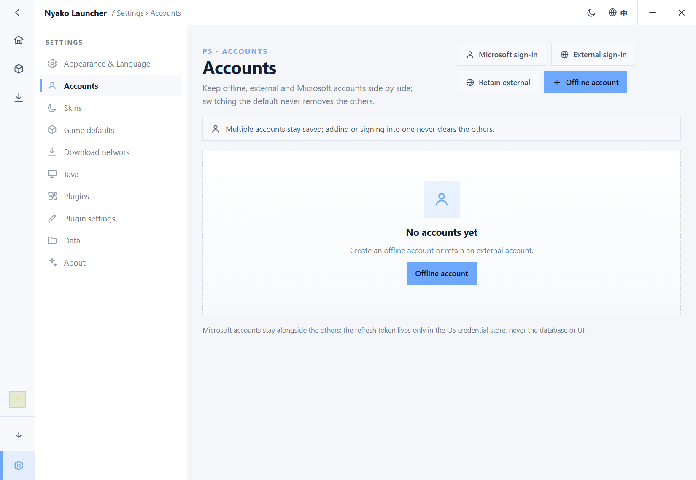
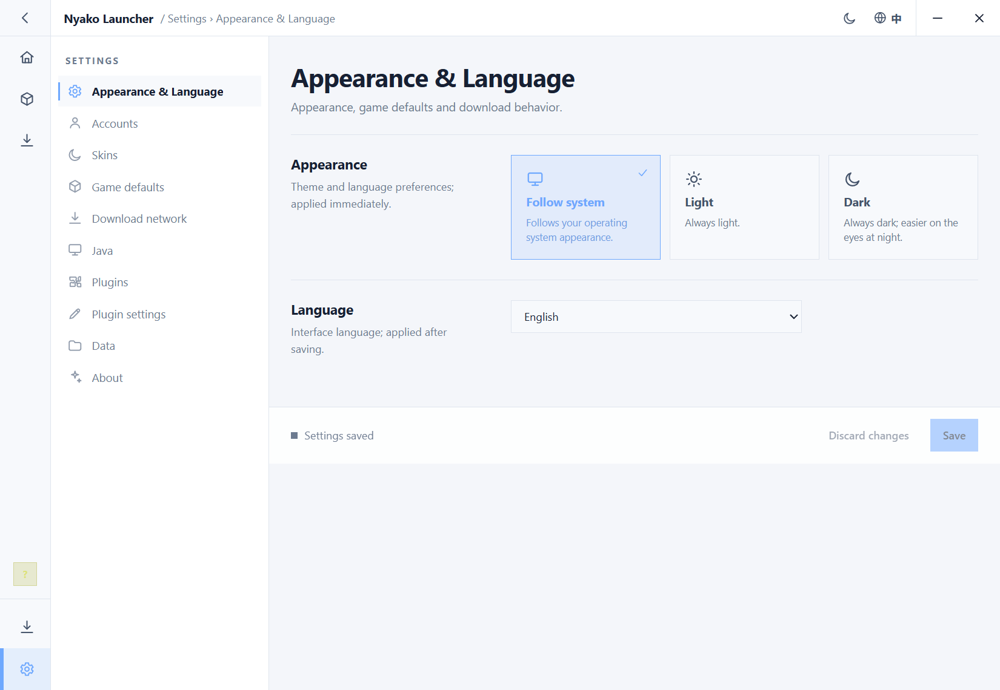

# Nyako Launcher

A third-party desktop launcher for **Minecraft: Java Edition** on Windows.

Nyako Launcher is an independent project. It is **not** affiliated with, endorsed by, or
sponsored by Mojang Studios or Microsoft.

## What it does

- **Instance management** — every instance has its own game directory, version, loader
  (vanilla / Fabric / Forge / NeoForge / Quilt), allocated memory and JVM arguments.
- **Official file downloads** — version manifests, client jars, libraries and assets are
  downloaded from Mojang's public services (`piston-meta.mojang.com`,
  `resources.download.minecraft.net`, `libraries.minecraft.net`) and verified by SHA-1.
- **Microsoft account sign-in** — the user signs in with their own Microsoft account through
  Microsoft's official OAuth 2.0 device-code flow, and the launcher starts the game with the
  Minecraft access token that Microsoft/Mojang issue for that account.
- **Offline accounts** — a local, unverified profile for LAN play and mod development, and
  "external" entries pointing at a user-supplied authlib-injector style API. Both are clearly
  labelled as unverified, and neither can join online-mode servers.
- **Plugin-first interface** — the UI (Tauri 2 + Rust + Vue 3) can be extended by plugins for
  declarative pages, home widgets and download providers. Light/dark theme, English/Chinese UI.

## Why the application needs Microsoft / Xbox / Minecraft API access

A third-party launcher cannot start Minecraft for a Microsoft account without going through
the same authentication chain the official launcher uses. Nyako Launcher performs exactly that
chain, and nothing else:

1. `POST https://login.microsoftonline.com/consumers/oauth2/v2.0/devicecode` — starts a
   device-code sign-in for the user's **personal** Microsoft account.
2. The user enters the displayed code on `https://www.microsoft.com/link` in their own browser.
   The launcher never sees the password; the user authenticates directly with Microsoft.
3. `POST https://login.microsoftonline.com/consumers/oauth2/v2.0/token` — exchanges the code
   for an OAuth token with the scopes `XboxLive.signin` and `XboxLive.offline_access`. These two
   scopes are the minimum required to identify the player and to keep the session alive; the app
   requests no mail, calendar, file, or profile-graph permissions.
4. `POST https://user.auth.xboxlive.com/user/authenticate` and
   `POST https://xsts.auth.xboxlive.com/xsts/authorize`
   (`RelyingParty = rp://api.minecraftservices.com/`) — converts the Microsoft token into an
   Xbox Live / XSTS token, the standard bridge between a Microsoft account and Xbox services.
5. `POST https://api.minecraftservices.com/authentication/login_with_xbox` — exchanges the XSTS
   token for a **Minecraft** access token, then `GET https://api.minecraftservices.com/minecraft/profile`
   to read the player's UUID and skin. This token is required to launch the game and to join
   online servers; without it the launcher can only offer offline mode.

The application ID used for these requests is
`bf755a2d-9098-4800-ad2e-b94b6facac3d` (an Entra ID public client application).

## How credentials are handled

- The Microsoft password is **never** handled by the launcher — sign-in happens in the user's
  own browser on Microsoft's page (device-code flow, no embedded login form, no password field).
- The **refresh token** is written only to the Windows Credential Manager of the current user.
  It is never written to a file, the SQLite database, or the UI.
- The **access tokens** (Microsoft, Xbox, Minecraft) live in process memory only and are
  discarded when the launcher exits.
- Launching the game passes the Minecraft access token to the game process as the standard
  `--accessToken` argument, exactly as the official launcher does; this stays on the local
  machine.
- No telemetry, no analytics, no crash reporting, no account server. The only network traffic is
  Microsoft / Xbox / Mojang authentication, Mojang's version manifest and asset CDNs, and the mod
  and modpack APIs the user explicitly searches (Modrinth).

## Download and run

1. Download
   [NyakoLauncher-0.1.0-win-x64.zip](https://github.com/Hisuifeng/Nyako_Launcher/releases/download/v0.1.0/NyakoLauncher-0.1.0-win-x64.zip)
   (about 5 MB) from the [Releases](../../releases) page.
2. Extract it anywhere and run `nyako-launcher.exe`.
   The build is portable: launcher data is kept in `.nyako` under the working directory, game
   files in `.minecraft` (both are created on first start).
3. Open **Settings → Accounts → Microsoft sign-in**, enter the code shown on screen at
   `https://www.microsoft.com/link`, and the account is added.

## Requirements

- Windows 10 / 11, x64
- [Microsoft Edge WebView2 Runtime](https://developer.microsoft.com/microsoft-edge/webview2/)
  (preinstalled on current Windows 10/11)
- A Java runtime (the launcher can download a Temurin build for the instance if needed)

## Project status

Early alpha. The launcher is functional for vanilla, Fabric, Forge, NeoForge and Quilt
instances, but APIs and UI may still change. Known limitations of this build:

- Microsoft sign-in returns `403 Invalid app registration` until this application ID has been
  reviewed and allow-listed by Mojang for Minecraft Services.
- Only Windows x64 builds are published so far.
- No automatic updates yet; download a new release to upgrade.

## Contact

Bug reports and questions: **minecraftsuifeng@qq.com**

---

## 中文简介

Nyako Launcher 是一个面向 Windows 的第三方《我的世界》Java 版启动器，与 Mojang / 微软无隶属关系。

- 管理多个游戏实例（原版 / Fabric / Forge / NeoForge / Quilt），各自独立的游戏目录、版本、内存与 JVM 参数；
- 从 Mojang 官方服务与 CDN 下载版本清单、客户端、库与资源文件，并按 SHA-1 校验；
- 使用微软官方 OAuth 设备码流程登录个人微软账号，经 Xbox Live → XSTS → Minecraft Services 换取
  游戏令牌后启动游戏；
- 支持离线账号与外置登录（均标注为未验证），以及可扩展的插件化界面（浅色/深色、中英文）。

刷新令牌只保存在 Windows 凭据管理器的当前用户下，访问令牌只存在进程内存，程序不含遥测、
不上传账号数据；除微软/Xbox/Mojang 认证、Mojang 资源 CDN 与用户主动搜索的 Modrinth 外没有其他网络请求。
